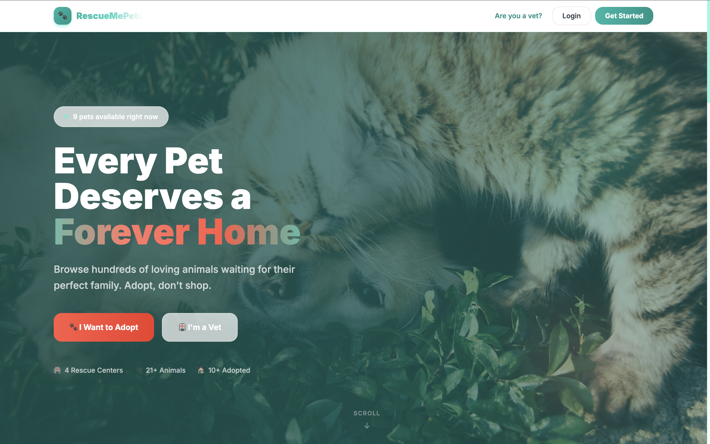
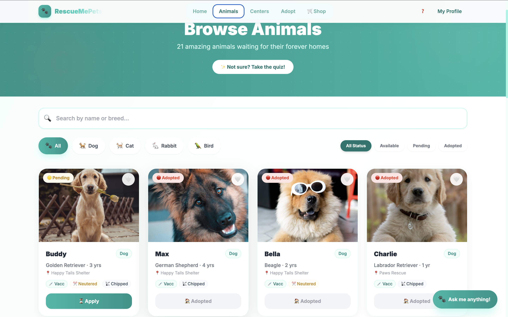
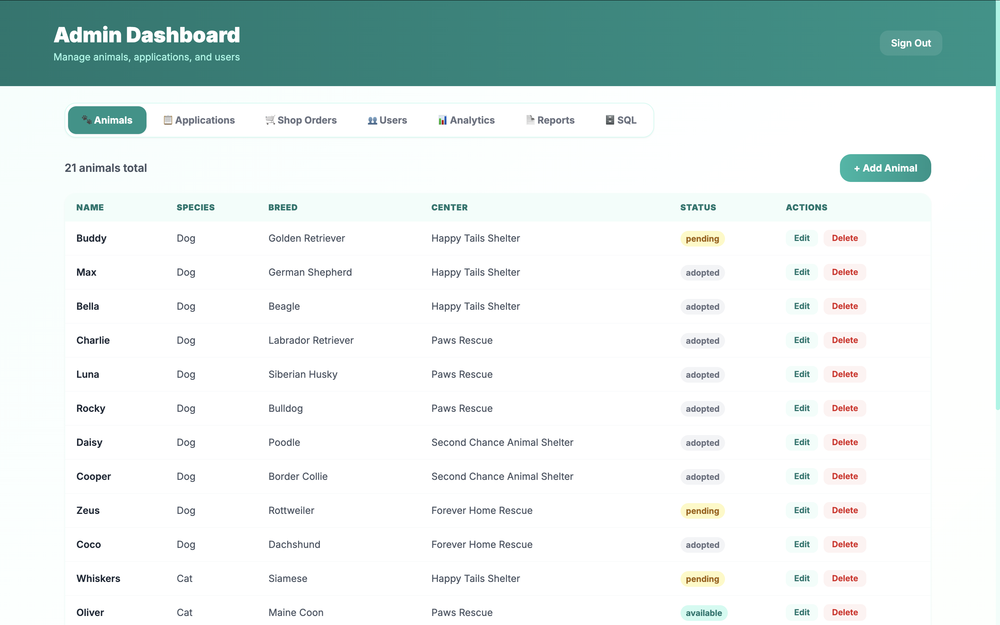

# RescueMePets

RescueMePets is a full-stack pet adoption platform that connects adopters, rescue centers, vets, and administrators in one system. The application supports browsing animals, submitting adoption and foster applications, managing medical records, handling support tickets, and tracking notifications and payments.





## Why this project

This app is designed to make rescue operations more transparent and easier to manage while giving adopters a smooth way to find and support pets.

## Key features

- Animal discovery with browsing, filtering, and favorites
- Adoption and foster-to-adopt workflows
- Vet portal for medical records and ticket management
- Admin dashboard for applications, analytics, and reports
- Real-time support chat and notification updates
- M-Pesa integration for adoption payments
- Push notifications and matchmaking quiz

## Tech stack

### Frontend
- React 18
- React Router
- Tailwind CSS
- CRA-based frontend setup

### Backend
- FastAPI
- SQLAlchemy
- PostgreSQL-ready configuration
- JWT-based authentication
- Pydantic validation
- Web push and notification support

## Project structure

```text
RescueMePets/
├── backend/
│   ├── main.py
│   ├── auth.py
│   ├── database.py
│   ├── models.py
│   ├── schemas.py
│   ├── requirements.txt
│   ├── .env.example
│   └── README.md
├── public/
├── src/
├── .gitignore
├── netlify.toml
├── package.json
├── package-lock.json
├── postcss.config.js
├── tailwind.config.js
├── README.md
├── screenshots/
└── rescuemepets.zip
```

## Quick start

### Prerequisites

- Node.js 22+
- Python 3.11+
- npm
- pip

### Frontend

```bash
npm install
npm start
```

The app runs on http://localhost:3000 by default.

### Backend

```bash
cd backend
python -m venv .venv
source .venv/bin/activate
pip install -r requirements.txt
cp .env.example .env
uvicorn main:app --reload
```

The API runs on http://localhost:8000 by default.

## Environment configuration

Copy the example backend environment file before running the API locally:

```bash
cp backend/.env.example backend/.env
```

The backend expects variables for things like:

- JWT secret
- database URL
- admin bootstrap values
- M-Pesa credentials
- VAPID keys for push notifications

Important:
- Never commit real secrets to version control
- Use strong production credentials
- Keep `ENV=production` only in deployed environments

For backend-specific deployment and configuration notes, see [backend/README.md](backend/README.md).

## User roles

- Visitor: browse animals, view rescue stories, and use the quiz
- Adopter: apply for adoption or foster-to-adopt and track status
- Vet: manage animals, logs, and support tickets
- Admin: review applications, manage users, and access analytics

## Contributing

1. Fork the repository
2. Create a feature branch: `git checkout -b feature/your-feature`
3. Commit your changes: `git commit -m "Add your feature"`
4. Push the branch: `git push origin feature/your-feature`
5. Open a pull request

## License

This project is licensed under the MIT License. See the [LICENSE](LICENSE) file for details.

---

Made with ❤️ for animals everywhere. Help a pet find their forever home. 🐾
